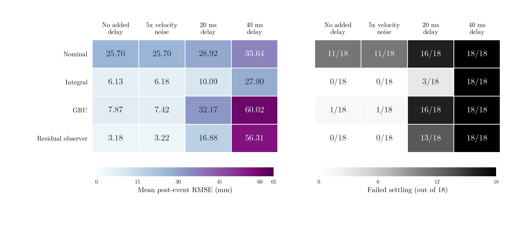

# Adaptive Trajectory Tracking

A torque-controlled Franka Panda follows an end-effector trajectory while payload, external forces, and actuator response change. This project compares learned compensation with classical control and measures where each approach helps or breaks down.

## Demo

https://github.com/user-attachments/assets/a28b24d5-d902-4308-956a-2ab4af406f15

Four controllers track the same reference with 0 ms and 40 ms actuator delay. The two chapters replay separate recorded simulations with the same camera, measurement noise, and disturbance schedule. A payload is added during motion; reference paths, tracking errors, and controller labels make the response visible.

The video shows one predefined case at approximately real-time speed. Each simulation lasts 24 seconds. The final results card summarizes eighteen paired cases per condition; the figure below also includes the noise and 20 ms tests.

## What the system does

The shared controller uses Cartesian position and orientation impedance, nominal gravity compensation, and a posture term for the redundant arm. End-effector forces map to seven bounded joint torques through the Jacobian. Physics runs at 500 Hz; commands update at 50 Hz.

| Controller | Compensation |
|---|---|
| Nominal | No additional disturbance estimate |
| Integral | Accumulated position error with anti-windup |
| GRU | Corrective force estimated from recent measurements and nominal dynamics residuals |
| Residual observer | A filtered inverse-dynamics residual projected into Cartesian force |

Payload and push truth affect the simulated plant, while controller models remain nominal. GRU weights stay frozen during each episode; adaptation comes from updating the force estimate using recent observations. This is online estimation, not online neural-network training.

## Results and engineering lessons

The robustness study runs **18 cases × 4 controllers × 4 conditions = 288 rollouts**. Cases cover payload changes, external pushes, and their combination on figure-eight, circle, and tilted-ellipse trajectories. References, initial states, event schedules, noise seeds, gains, and torque limits are paired.



Mean post-event position RMSE across eighteen cases:

| Condition | Nominal | Integral | GRU | Residual observer |
|---|---:|---:|---:|---:|
| No added delay | 25.70 mm | 6.13 mm | 7.87 mm | **3.18 mm** |
| Fivefold velocity noise | 25.70 mm | 6.18 mm | 7.42 mm | **3.22 mm** |
| 20 ms actuator delay | 28.92 mm | **10.09 mm** | 32.17 mm | 16.88 mm |
| 40 ms actuator delay | 35.64 mm | **27.90 mm** | 60.02 mm | 56.31 mm |

- **A simple physical estimator is the strongest tested option without delay.** The residual observer has the lowest mean error under both noise levels. The GRU does not outperform the best classical comparator.
- **Position accuracy alone hides actuator activity.** Fivefold velocity noise changes observer RMSE from 3.18 to 3.22 mm, while its mean applied torque-rate RMS rises from 38.41 to 181.92 Nm/s.
- **Delay changes the ranking and exposes a shared limitation.** Integral compensation has the lowest error at 20 ms. At 40 ms, every controller fails final settling in all eighteen cases. All 288 rollouts complete numerically; completion does not mean successful tracking.

These findings motivate improving delay tolerance and actuator behavior before increasing neural-network complexity. The study uses one frozen checkpoint and development cases, so it does not establish general superiority or hardware readiness.

[Control design and experimental limits](docs/method.md) · [Episode measurements](results/robustness/episode_metrics.csv) · [Scenarios](results/robustness/scenarios.json)

## Run it

Use Python 3.12. CPU execution is sufficient for the included estimator and experiments. A graphics context is required only for the interactive viewer.

```bash
python -m venv .venv
# Activate .venv using your shell's activation command.
python -m pip install -r requirements-panda.txt
python -m pip install "torch==2.2.0" --index-url https://download.pytorch.org/whl/cpu
git clone --filter=blob:none --sparse https://github.com/google-deepmind/mujoco_menagerie.git third_party/menagerie
git -C third_party/menagerie sparse-checkout set franka_emika_panda
git -C third_party/menagerie checkout 0059d4335f8156206f63a35662313385f7ad6d74
```

Run the nominal/GRU payload-and-push experiment using the included checkpoint:

```bash
python scripts/run_panda.py --model-dir third_party/menagerie/franka_emika_panda --reuse-checkpoint checkpoints/panda_gru.pt --output outputs/panda/demo
python scripts/view_panda.py --model-dir third_party/menagerie/franka_emika_panda --trace outputs/panda/demo/adaptive_gru_rollout.npz
```

The runner saves paired traces, metrics, configuration, and provenance. Use a fresh output directory for each run. The viewer replays recorded joint states and displays reference and actual paths; it does not drive the robot by setting reference poses.

[Training, four-controller evaluation, and verification commands](docs/reproduce.md)

## Repository

| Path | Responsibility |
|---|---|
| `src/panda/tracking.py` | Torque plant, controllers, features, and GRU training |
| `scripts/run_panda.py` | Paired nominal/GRU experiment |
| `scripts/view_panda.py` | Interactive playback of saved simulation states |
| `scripts/benchmark_panda*.py` | Calibration, paired evaluation, noise/delay experiments |
| `scripts/verify_panda_robustness.py` | Saved-trace consistency checks |
| `configs/`, `checkpoints/` | Experiment settings and frozen model |
| `results/robustness/`, `tests/` | Measurements and regression checks |

The original NumPy point-mass implementation remains available in `src/dynamics/`, `src/controllers/`, and the shared training/evaluation modules for controlled 2D learning experiments. Panda is the primary demonstration.

## Scope

The controller is Cartesian impedance with kinematic force-to-torque mapping, not full dynamically consistent operational-space control. Payload attachment is an instantaneous mass/inertia change without attachment impact. Delay is present from startup and uses a zero-initialized torque queue. Sensor noise is applied to joint velocity; end-effector observations remain ideal.

Historical traces sample joint poses and cached end-effector positions at different simulation-update stages. Reported metrics use the recorded positions; rendered poses can differ slightly from those samples. See the method notes before interpreting millimeter-scale differences.

The next experiment is a separately calibrated, delay-tolerant classical baseline, evaluated on tracking error and torque-rate together, followed by learned compensation only if it adds measurable value.

## Model attribution

The Franka Panda model comes from [MuJoCo Menagerie](https://github.com/google-deepmind/mujoco_menagerie/tree/0059d4335f8156206f63a35662313385f7ad6d74/franka_emika_panda), under its Apache-2.0 license. Model assets are downloaded separately and pinned to the revision used for evaluation.
