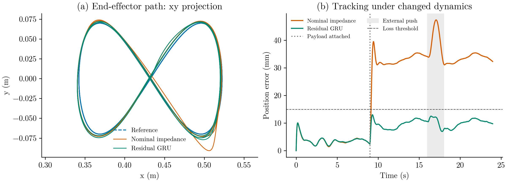

# Adaptive Trajectory Tracking

**Physics-informed control meets recurrent residual estimation.** A torque-driven Franka Panda follows a Cartesian trajectory while its payload and external forces change. This project connects system modelling, feedback control, supervised learning, reproducible experiments, and scientific visualization.

## Demonstration

https://github.com/user-attachments/assets/0226c782-a70d-4f6a-8761-5ebfdaa67fc4

[Download comparison MP4](outputs/panda/franka_payload_v1/comparison.mp4)

**26 seconds · 1920 × 1080 · H.264 · 30 fps.** A 3D figure-eight with fixed end-effector orientation, a **1.5 kg payload added at 9 s**, and a **12.8 N peak external push during 16–18 s**. Blue marks the reference; orange and green mark nominal and adaptive paths. Events, error, estimated compensation, and shared-scale plots remain visible throughout.

[Nominal controller](outputs/panda/franka_payload_v1/baseline.mp4) · [Adaptive controller](outputs/panda/franka_payload_v1/adaptive_gru.mp4) · [Metrics](outputs/panda/franka_payload_v1/metrics.json)

## Engineering contribution

The challenge is to preserve accurate motion when the dynamics assumed by the controller become wrong. Shared Cartesian impedance supplies nominal behaviour. A compact GRU estimates corrective force from recent measurements and nominal inverse-dynamics residuals. The correction reaches physical torque actuators through the end-effector Jacobian.

- **Seven bounded torque actuators:** physics at 500 Hz, control at 50 Hz.
- **Position and orientation impedance:** nominal gravity compensation and a nullspace posture term for the redundant arm.
- **48-unit GRU, 240 ms history:** 48 randomized training episodes; best weights selected using 12 held-out validation episodes.
- **Causal inference:** joint velocity, end-effector state, previous torque, nominal dynamics, and nominal task force. Event time, changed mass, and applied-force truth never enter observer inputs.
- **Paired evaluation:** identical references, disturbances, noise seeds, impedance gains, nominal models, and torque limits.

Only the plant receives changed payload mass/inertia and external force. The nominal model and network weights stay fixed during an episode; residual estimates update online.

## Measured results

### Panda showcase

| Metric | Nominal impedance | Impedance + residual GRU |
|---|---:|---:|
| Pre-change position RMSE | 3.94 mm | 3.98 mm |
| Post-change position RMSE | 34.10 mm | **9.98 mm** |
| Peak position error | 47.34 mm | **13.01 mm** |
| Orientation RMSE | 0.55° | 0.54° |
| Torque saturation | 0% | 0% |

**Post-change RMSE decreases by 70.7%** in this fixed demonstration. Adaptive tracking stays within the 15 mm loss threshold; nominal tracking fails to settle within it. Similar pre-change error separates disturbance compensation from nominal tracking quality.

This is a reproducible showcase, not a broad manipulation benchmark. Payload attachment is an ideal instantaneous mass/inertia change that preserves state without modelling attachment impact.



### Original 2D benchmark

The NumPy plant supports controlled learning experiments with mass, viscous friction, actuator delay, and disturbance shifts, including held-out trajectories and compound shifts.

| Controller | RMSE, mean ± training-seed std | Success |
|---|---:|---:|
| Nominal controller | 0.20078 m | 86.51% |
| Adaptive MLP | 0.14088 ± 0.00154 m | 98.15% |
| GRU, nominal inference | **0.12708 ± 0.00261 m** | **98.68%** |
| GRU, uncertainty-aware inference | 0.12826 ± 0.00027 m | 98.28% |

Three training seeds use fixed datasets and **252 identical scenarios**: 108 in-distribution, 36 held-out trajectory, and 108 compound-shift cases. GRU variants share identical weights within each seed and differ in the uncertainty-enabled inference branch. Their average RMSE difference is small; its exploratory paired interval includes zero.

[Seed summary](results/xy_multiseed_summary.csv) · [Paired comparisons](results/xy_paired_comparison.csv)

Historical `outputs/research/paper_best` artifacts predate checkpoint snapshot and recovery corrections. They are retained as legacy evidence and are not substituted for the corrected numbers above.

## Reproduce

Use Python 3.12 in a virtual environment:

```bash
pip install -r requirements-panda.txt
python scripts/install_torch.py --mode auto
git clone --filter=blob:none --sparse https://github.com/google-deepmind/mujoco_menagerie.git third_party/menagerie
git -C third_party/menagerie sparse-checkout set franka_emika_panda
git -C third_party/menagerie checkout 0059d4335f8156206f63a35662313385f7ad6d74
```

Reproduce the videos using the included 49 KB checkpoint:

```bash
python scripts/run_panda.py --model-dir third_party/menagerie/franka_emika_panda --output outputs/panda/franka_payload_v1 --reuse-checkpoint outputs/panda/franka_payload_v1/panda_gru.pt
```

Train a fresh Panda observer and produce three videos:

```bash
python scripts/run_panda.py --model-dir third_party/menagerie/franka_emika_panda --output outputs/panda/new_run
```

Smoke checks and regression tests:

```bash
python scripts/run_panda.py --model-dir third_party/menagerie/franka_emika_panda --output outputs/panda/smoke --smoke --skip-render
python -m unittest discover -s tests -v
```

Rendering uses GLFW on Windows and EGL on Linux. Bundled **Latin Modern Roman 10** supplies reproducible typography; the white layout and colourblind-friendly palette emphasize measurements. Rendering replays physical states. Live control never forces `qpos` to a reference. MP4s use H.264, YUV420p, and fast-start metadata.

The original benchmark is independently runnable:

```bash
python scripts/smoke_p0.py
python scripts/run_multiseed.py --seeds 123 124 125 --device cuda --output-subdir research/new_multiseed_run
```

## Repository map

| Location | Responsibility |
|---|---|
| `src/panda/tracking.py` | Torque plant, controller, causal features, GRU training |
| `src/panda/render.py` | Scientific video layout, trails, event annotations |
| `scripts/run_panda.py` | Paired rollout, metrics, provenance, MP4 generation |
| `configs/panda.yaml` | Clocks, gains, events, training settings |
| `src/dynamics/`, `src/controllers/` | Original 2D plant and controllers |
| `src/training/`, `src/evaluation/` | Training and paired benchmark evaluation |
| `tests/` | Snapshot, recovery, pairing, payload continuity, torque checks |

## Validation and limits

Checkpoint selection copies the best validation weights. Recovery distinguishes no loss, successful final settling, and failure; undefined times stay undefined. The Panda check verifies state continuity, unchanged nominal dynamics, exact zero-residual parity, and bounded torque.

Config, sampled training scenarios, validation history, rollouts, checkpoint, and hashes accompany the demonstration. The learned force label represents payload gravity minus external push, not complete identification of arm dynamics. The GRU is a learned residual observer, not online weight optimization. Stronger evidence would add an analytical disturbance observer, more training seeds, unseen payload/force combinations, sensor delays, and contact tasks.

## Attribution

Panda uses the Apache-2.0 [MuJoCo Menagerie model](https://github.com/google-deepmind/mujoco_menagerie/tree/main/franka_emika_panda), pinned to the revision above. Unmodified Latin Modern fonts by Bogusław Jackowski and Janusz M. Nowacki use the [GUST Font License](assets/fonts/latin-modern/GUST-FONT-LICENSE.txt).
